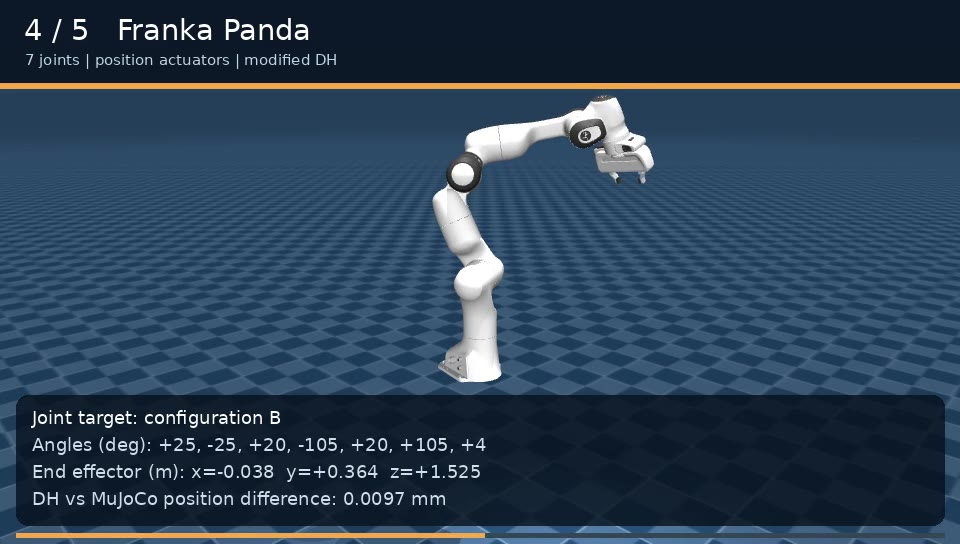
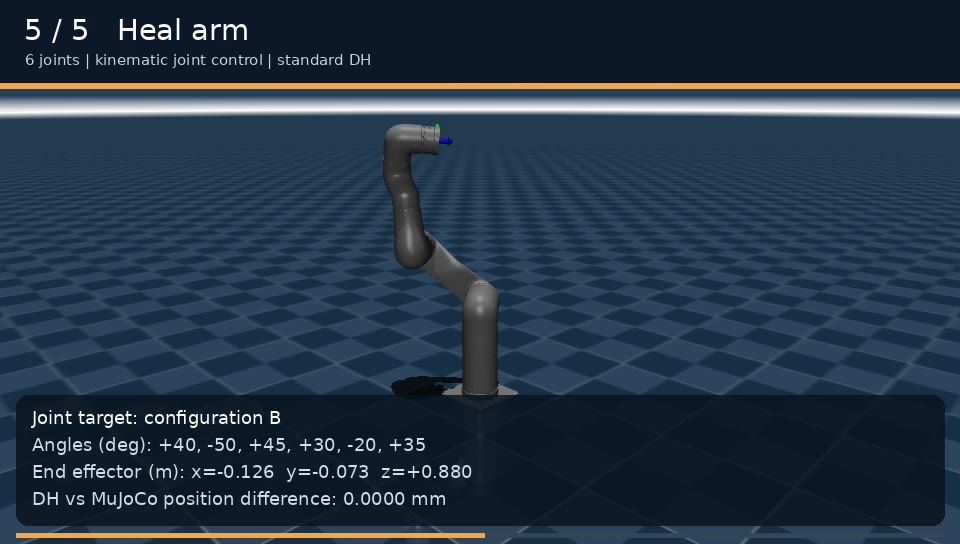
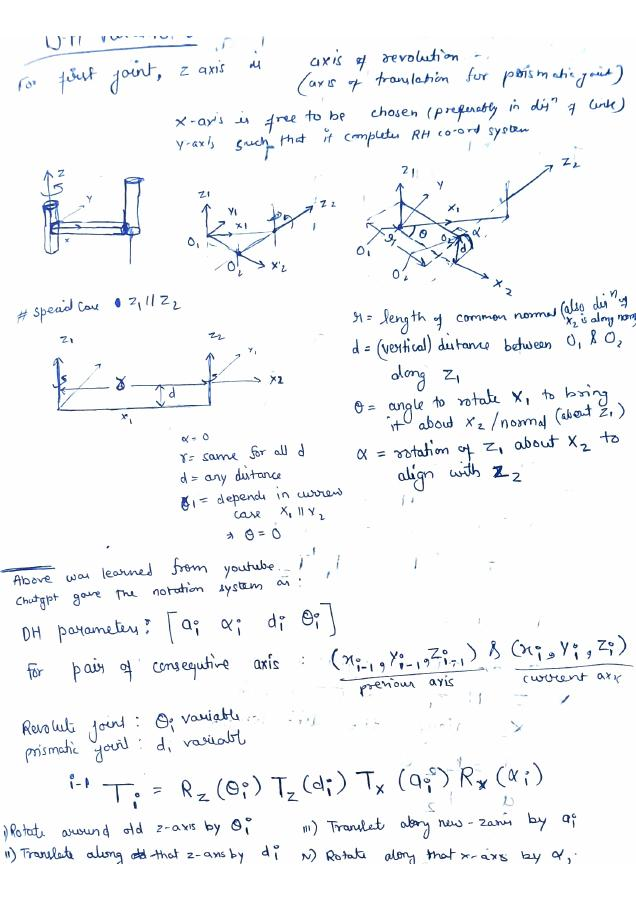

# Lab 2: Franka and Heal arm control and forward kinematics

The MuJoCo app in `franka_joint_ui/` loads the supplied Franka Panda and Heal
models. Choose an arm in the UI, enter target joint angles in degrees, and
move it to the requested configuration. The Franka arm uses its position
actuators; Heal uses kinematic joint updates for this forward-kinematics lab.

## Demonstrations

| Franka Panda | Heal arm |
| --- | --- |
| [](media/franka.mp4) | [](media/heal.mp4) |
| [Video](media/franka.mp4) | [Video](media/heal.mp4) |

Each video shows two commanded configurations and the difference between the
DH end-effector position and MuJoCo's pose. These are scripted simulation
captures; use the app for interactive joint control.

## Setup and run

Use Python 3.10 or newer and a desktop with OpenGL support. From this folder:

```bash
python3 -m venv .venv
source .venv/bin/activate
python -m pip install -r franka_joint_ui/requirements.txt
python franka_joint_ui/app.py
```

On Windows, activate with `.venv\Scripts\activate` and use `python` in place
of `python3` to create the environment. Start on Heal with
`python franka_joint_ui/app.py --robot heal`.

The app's Robot menu switches arms. Enter joint angles or use the sliders;
**Move to configuration** applies the target and **Return home** resets the
selected arm. Joint limits and current angles are displayed in the panel.

## Part 3: handwritten DH derivation

[View the scanned two-page DH derivation](report/handwritten-dh-derivation.pdf).
It covers coordinate frames, DH parameters, special axis cases, and the
homogeneous transform construction.

[](report/handwritten-dh-derivation.pdf)

## DH forward kinematics

`python_script_for_dh_tran.py` implements standard and modified DH matrices
from scratch using NumPy. The Franka calculation uses modified DH, and Heal
uses a standard DH table derived from the supplied model's joint axes. The
script prints each joint transformation and the final end-effector position
and orientation. Its generic six-joint example is separate from Heal.

```bash
python python_script_for_dh_tran.py
python -m unittest -v test_dh
python -m unittest discover -s franka_joint_ui -v
python franka_joint_ui/app.py --check --robot franka
python franka_joint_ui/app.py --check --robot heal
```

`test_dh.py` compares the independent DH calculations with MuJoCo at multiple
configurations. `franka_joint_ui/fk_from_scratch.py` is a separate XML-chain
calculation and is not the DH assignment script.

## Model attribution

The Franka model is from MuJoCo Menagerie; its license is preserved in
`franka_joint_ui/models/franka/LICENSE`. The Heal model and meshes were
supplied with the course starter files.
