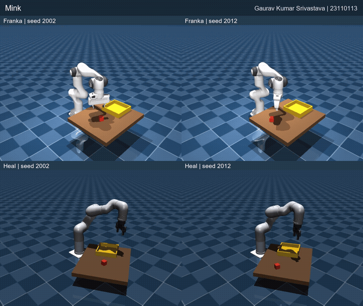

# Lab 3 — Pick and place with Franka and Heal

**ME 639: Introduction to Robotics · AY 2026–27**

**Gaurav Kumar Srivastava · 23110113**

**Instructor:** Professor Madhu Vadali

This submission implements a MuJoCo pick-and-place task for the Franka Panda
and Heal arms. It compares three inverse-kinematics methods—Mink, damped least
squares (DLS), and quadratic programming (QP)—on a workspace-sized table and
an additional fixed-size placement layout. The code, model assets, recorded
results, report, and demonstration are included in this folder.

## Submission artifacts

- [Five-page report](report/ME639_Lab3_23110113_Report.pdf)
- [Full demonstration video (MP4, 2 min 13 s)](video/ME639_Lab3_23110113_Demonstration.mp4)
- [Animated video preview](video/lab3_preview.gif)
- [Summary metrics](results/metrics.csv) and [full evaluation records](results/)



The video presents six four-pane sequences: two seed pairs for each IK method,
with Franka above Heal. It uses the placement layouts at 0.622× simulation
speed. The full MP4 includes the entire pick-and-place sequences; the animation
above is a short preview.

## What is included

| Path | Contents |
| --- | --- |
| `run_lab.py` | Command-line entry point for robot, IK method, layout, seed, and recording |
| `code/` | Scene construction, IK, physical controller, and workspace/table studies |
| `models/` | Franka, Heal, and Robotiq assets with available license/provenance files |
| `results/` | 300 evaluation records, selected layouts, and metrics |
| `figures/` | Workspace, IK, successful sequence, and clearance figures |
| `report/`, `video/` | Submission PDF and demonstration MP4 |
| `tests/`, `tools/` | Reproducibility and package checks |

## Install and run on Ubuntu

Use Python 3.12 and a fresh virtual environment. Ubuntu needs OpenGL libraries
for rendering; the physics checks can run without a display.

```bash
sudo apt install python3-venv libgl1 libegl1 libglfw3
python3.12 -m venv .venv
source .venv/bin/activate
python -m pip install -r requirements.txt
python -m pip check
```

From this `Lab 3` directory, run one robot/method, or all six combinations:

```bash
python run_lab.py --robot franka --method mink --layout sizing --seed 3100
python run_lab.py --robot heal --method dls --layout sizing --seed 3100
python run_lab.py --robot both --method all --layout sizing --seed 3100
python run_lab.py --robot both --method all --layout placement --seed 2000
```

`--robot` accepts `franka`, `heal`, or `both`; `--method` accepts `mink`, `dls`,
`qp`, or `all`. A run writes JSONL logs to ignored `runs/`. Use `--output PATH`
for another output directory. The `sizing` layout is the main workspace-based
table design; `placement` is the additional fixed-size position/yaw study.

To record a complete physical episode, add `--record`:

```bash
MUJOCO_GL=egl python run_lab.py --robot heal --method qp --layout sizing --seed 3100 --record
```

If EGL is unavailable on the local driver, run from a graphical desktop with
the default GLFW backend. `MUJOCO_GL=osmesa` is another option if `libosmesa6`
is installed.

## Verify the submission

```bash
python tools/check_submission.py
MUJOCO_GL=egl python tools/check_submission.py --render
python plot_results.py
```

The checks load both models, validate Jacobians, DLS/QP behavior and bounds,
check both layouts, and check the supplied evaluation groups. The rendering
check saves two PNGs under ignored `runs/`; plotting saves figures under
`runs/plots/`. To create a clean ZIP, run `python tools/bundle.py`.

[Ubuntu validation results](UBUNTU_VALIDATION.md) record the platform and
commands actually tested.

## Results and limits

Each robot/method has 25 recorded episodes per layout. The workspace-sized
study achieved 150/150 constraint-safe placements. On the placement study,
Franka achieved 75/75 and Heal achieved 73/75; the two Heal QP pre-grasp
timeouts at seeds 2004 and 2018 are documented outcomes. These are simulation
results, not hardware trials. Historical data names remain unchanged:
`workspace_sized_alternative` means `sizing`, and `fixed_size_selected` means
`placement`.

The controller is actuator-driven and monitors grasp, lift, transfer, release,
clearance, joint limits, and speed. `code/ik.py` implements the three IK
backends. Longer workspace and layout searches are reproducible from `code/`
but are not run by the standard verification command.
